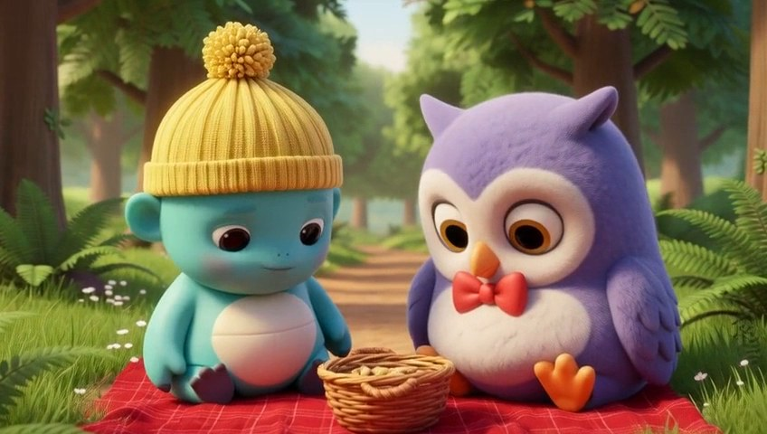
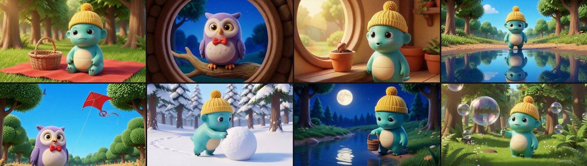
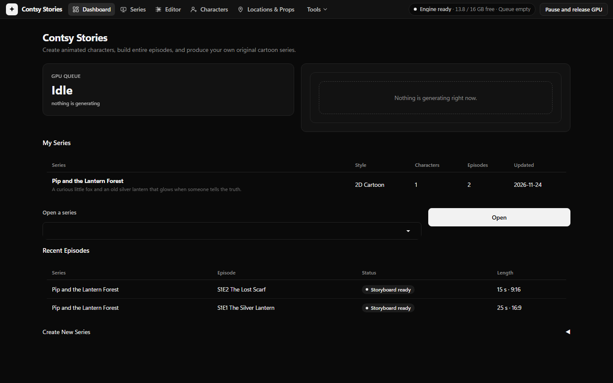
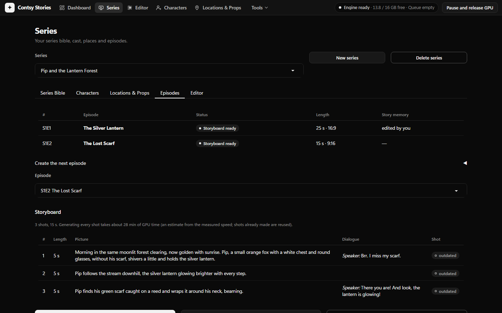

# Contsy Stories

### An AI animated-series studio that runs on your own PC

Design your characters once, write a series bible, and make cartoon episodes with consistent characters, narration, dialogue, music and subtitles.

Free and open source · No account · Runs on NVIDIA graphics cards from 8 GB

AI-generated with Contsy Stories.

## What it does

Contsy Stories is for creators and small studios who make their own animated series: YouTube cartoons, animated Shorts, an independent series. It is not a general AI video tool and does not make realistic ads.

- **Series Bible and story memory.** Every series has a bible: premise, world, rules, tone, storytelling, animation style, default format and narration, audience, narrator voice, relationships between the characters and the facts the story must keep. After each episode its summary, its new facts and the story so far are saved, and the next episode is written with all of it. You can correct every summary and fact; your own text is never overwritten by the agent, and a fact you retire no longer reaches it.
- **A new series in 7 steps.** Name and premise, animation style, main character (name, kind, look, colors, outfit, personality), voice, the first episode (16:9 or Shorts 9:16, 15 seconds to 15 minutes, dialogue, narrator or both), storyboard review, generate. No sampler, model or weight settings on the way.
- **Episodes you approve before anything is made.** The story agent writes the storyboard: shots, lengths, dialogue, narration and title cards. Nothing is generated until you press **Approve storyboard and generate**. Long episodes are split into chapters of at most 3 minutes, so a failure costs one chapter and a stopped run resumes where it ended. After an episode, chat with the agent to change a scene; it changes only that scene.
- **Characters that stay the same.** Each character has a design sheet (kind, role, look, signature colors, silhouette, outfit, distinctive marks, personality, outfit variants, voice) linked to a library character with its reference pictures and its own voice: described, cloned from a short recording or picked from 20 bundled voices. Nothing is trained, so a character is ready in minutes.
- **Locations & Props.** Recurring places and props get reference pictures once; every shot that names them is composed from those pictures, so the house, the lake and the lantern look the same in every episode.
- **The Editor (Timeline).** Every episode opens as one or more Timeline projects: preview, scene fixes, **takes** (every version of a scene stays, and an earlier one can be put back), **title cards** as exact text overlays (never drawn by the video model, and moved away from the characters' faces), **subtitles** burned in on export, and the MP4 export.
- **Narrator voice-over.** A narrator line is spoken by a library voice over the picture. In the animated styles it moves no mouth, which saves GPU time on narrated scenes.
- **Animation styles.** 2D Cartoon, Stylized 3D Cartoon and Anime are tuned and ready. Storybook Illustration, Clay Animation, Paper Cutout and Comic Animation are experimental: the same models with style words, not tuned yet. No style names or imitates a franchise.
- **Agent** (with your own Claude API key): the story agent that writes the storyboards and produces the episodes with Contsy's own tools, and the **Agent** page, where it builds any project from a brief you attach. Its text goes to Anthropic; see the privacy question in the FAQ. Without a key you build storyboards by hand in the Editor.

### The quality layer

The agent does not grade its own work. Code, data and an independent check do:

- **ShotSpec shot contract.** Each shot is data, not free prose: location, time of day, one action, a camera from a fixed list, cast, 1 to 3 key visuals, props, what it must and must not show. The studio validates it against the bible and compiles the prompt itself, with every named character's reference picture and canonical words.
- **Independent shot QC with retries.** Every keyframe and every clip is checked by CPU detectors (colour, backdrop, motion, framing) and by the local vision model. A failing shot is made again with a new seed (two retries), then marked for your review.
- **QC report.** Each export writes a report with frames of every shot, the verdicts and the sound measurements. An episode only counts as complete when every shot and the sound pass.
- **Episode mix at −14 LUFS.** One ambience bed per place, cross-faded only when the place changes, ducked under the narrator; narration paced at a calm reading speed; the whole episode mastered to −14 LUFS with a true-peak limit.
- **Music library.** Put licensed music tracks in the `music` folder of your Contsy folder and the mix lays them under the narration. Nothing is downloaded or generated: with an empty folder an episode has no music, and the QC report says so.

The check catches a lot but not everything: in the regression set it failed 16 of 23 defective shots and none of the 4 good ones, and it still misses small or subtle defects. See [docs/QUALITY_ARCHITECTURE.md](docs/QUALITY_ARCHITECTURE.md).

### The engine

Pictures, video, speech and sound are generated by Contsy's own local engine, with PyTorch for inference and PyAV for media:

- **Video:** Wan 2.2 with the LightX2V 4-step distillation, and Index-AniSora V3.2 for the motion of Anime and 2D cartoon films (optional, Full set)
- **Pictures:** Z-Image Turbo and Qwen Image Edit 2511 (reference pictures and shot keyframes)
- **Speech:** VoxCPM2
- **Lip sync:** InfiniteTalk for a talking animated character, MuseTalk 1.5 for scenes with several speakers in 3D films
- **Ambience and effects:** EzAudio-XL
- **Frame interpolation:** RIFE 4.9
- **Prompt assistant and shot check:** Qwen3.5 9B

Every model is downloaded from its authors (or a named conversion), pinned to an exact version and checked with SHA-256. See [MODEL_LICENSES.md](MODEL_LICENSES.md).

## Showcase: Lumi and the Lantern Woods

  

Stills from *Lumi and the Lantern Woods*, eight short episodes made with Contsy Stories. **All pictures are AI-generated.**

## Screenshots

  
  

## Install in 3 steps

1. **Download:** green **Code** button → **Download ZIP**, then extract it to `C:\Contsy`.
2. **Double-click `install.bat`** and type **1** (Lite) or **2** (Full quality). It recommends the right one for your graphics card. Then leave it running: it installs everything and downloads the models of that set. That can take from about 30 minutes on a fast connection to a few hours.
3. **Double-click `start.bat`.** Contsy Stories opens in your browser on the Dashboard, with **Create New Series** ready.

> If Windows shows *“Windows protected your PC”*, click **More info → Run anyway**.

To let the agent write your episodes, open **Tools → Agent**, paste your Claude API key and click **Save key**.

## Which model set is for me?

| | **Lite** | **Full quality** |
| --- | --- | --- |
| NVIDIA graphics card | 8 GB or more | 16 GB or more (12 GB works) |
| RAM | 32 GB | 64 GB recommended (the video model stays loaded between continuing parts and scenes) |
| Free disk space | 135 GB | 180 GB |
| Result | Great | Best detail |

Both sets have the same features and need Windows 11 and an SSD. You can switch later in **Settings → Model set**. Drawn-animation motion (Index-AniSora) and the faster FP8 video experts are optional extras of the Full set.

## FAQ

**Is it free?** Yes. Contsy Stories is free and open source, with no account, subscription or usage limit, and you can use it for commercial work too. The AI models keep their own licenses: see [model licenses](MODEL_LICENSES.md). The optional agent runs on your own Claude API key, which Anthropic bills directly; every run has a cost limit you set.

**Do my photos leave my computer?** Not by default. Generation runs locally; the internet is needed for installation and model downloads. The one optional exception is the **Agent**, which also writes and produces the episodes of a series: once you save a Claude API key and start a run, your brief or episode request, the series bible, the texts of scenes and characters and, unless you turn off *Send images to the cloud* (it is on by default, so the agent can look at what it makes), the pictures of characters and places it made, frames of clips and of the finished film go to Anthropic. The agent never sends pictures of a character or place made from a photo you uploaded, and never sends sound. The shot check's optional Claude second opinion (off unless you set `"qc": {"arbiter": true}` in your settings) uses the same key and sends the frames and reference pictures of the shots the local model is unsure about. With no key saved, Contsy never contacts Anthropic.

**What resolution are the videos?** 480p at 30 FPS (848×480 in 16:9, 480×848 for Shorts in 9:16), made with Wan 2.2 and the LightX2V 4-step distillation; nothing is upscaled.

**How fast is it?** Slow on consumer graphics cards. On an RTX 4070 Ti Super (16 GB) with 64 GB of RAM, a shot of up to 6 seconds takes about 3.5–5 minutes including its keyframe and both checks, and an 83-second test episode of 18 shots took about 2.5 hours of GPU time, mostly because failing shots were made again. Smaller cards are slower. Generation runs in the GPU queue, which survives restarts; **Pause and release GPU** frees the card at once.

**Mac, Linux or AMD?** Not yet. Contsy needs Windows and an NVIDIA graphics card.

**Does Contsy filter content?** It refuses any text that combines minors with sexual content, refuses sexual content with animals and creatures, and asks for consent for uploaded photos and cloned voices. Characters are adults or fully grown animals and creatures: “a small fox” or “a tiny robot” works, “a baby dragon” or “a little kitten” is refused. Every reference photo of a character must show one adult (or, for an animal or creature character, no person under 18). It does not check results for adult content, so review what you make before you publish it. Every result carries an “AI-generated” tag in its metadata. See [privacy and safety](docs/GUIDE.md#privacy-and-safety).

**Something went wrong?** See [Troubleshooting](docs/GUIDE.md#troubleshooting).

## For developers

- **Stack:** Python 3.12, a Gradio app in one process (`app/`), the native PyTorch engine (`engine/`), the GPU queue and the story agent in the same app. Contsy listens only on `127.0.0.1`.
- **Unit tests** (no GPU, no models): `python -m unittest discover -s tests`, run from the project folder with the installed environment (`venv\Scripts\python.exe -m unittest discover -s tests`).
- **CI:** GitHub Actions runs the unit tests on Windows with the CPU build of PyTorch on every push and pull request (`.github/workflows/tests.yml`).
- **Docs:** the [user guide](docs/GUIDE.md), the [product description](docs/CONTSY_STORIES_PRODUCT.md), the [architecture](docs/CONTSY_STORIES_ARCHITECTURE.md) and the [quality architecture](docs/QUALITY_ARCHITECTURE.md). Also see [contributing](CONTRIBUTING.md) and [security](SECURITY.md).

## License

Contsy Stories is free software under the [GNU GPL v3.0](LICENSE) (`GPL-3.0-only`). You may use it, including commercially, and study, change and share it. If you share Contsy or a changed version of it, you must make its source code available under the same license. The AI models and other third-party components keep their own licenses: see [MODEL_LICENSES.md](MODEL_LICENSES.md), [licensing](docs/LICENSING.md) and [third-party notices](THIRD_PARTY_NOTICES.md). © 2026 Karol Kosciolek.

**If you like Contsy Stories, give it a ⭐ so other creators can find it.**

