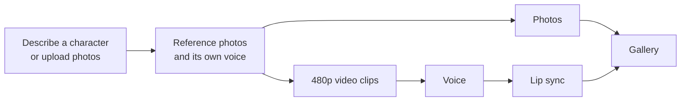

# Contsy Studio guide

Everything the [README](../README.md) leaves out: what each feature does, the two model sets in detail, measured speed, installation details, updating, troubleshooting, privacy and safety.

> **Pages in Contsy Stories.** The app shows Dashboard, Series, Editor, Characters, Locations & Props and, under Tools, Agent, Voices, GPU Queue and Settings. Locations & Props is the page this guide calls Items. The older studio pages this guide also describes (Video, Image, Gallery, Universes and Styles) are hidden in Contsy Stories; their features are used through the Series workspace, the Editor and the agent.

## Features

- **Series.** Contsy Stories organises your work as animated series: a Series Bible and story memory, character sheets, recurring places and props, and episodes whose storyboards the agent writes and you approve before anything is generated. See [Series](#series).
- **Characters.** A character is a name, a gender, a look description, 1 to 8 reference photos of one adult and its own voice, all made on one screen of the **Characters** page and saved together; in the animated styles it can also be a fully grown animal or creature. Describe the look and Contsy draws the first photo, then the other views of the same person from it (each one checked: one adult, one face, the same face as the first); or upload your own photos of a consenting adult. Describe the voice and Contsy designs it, or clone it from a 3–12 second recording, or start from a bundled voice. Nothing is trained, so a character is ready in minutes. See [Characters](#characters).
- **Places and items.** A place your characters often appear in (a TV studio, a kitchen) or an object (a news desk, a red bicycle) gets reference photos the same way, on the **Items** page, in the film's style. Pick it for a scene in the Timeline, or write its name in the scene's picture text, and the scene is composed with it. See [Places and items](#places-and-items).
- **Several characters in one video or photo.** Each character brings its own reference photos. Write their names in the prompt (“Ola hands Kuba a coffee”) and Contsy places each of them in the scene with their own face; group characters into **universes** to load a whole cast at once. See [Several characters and universes](#several-characters-and-universes).
- **Photos.** Square, landscape, 9:16 or 3:4. A prompt gives a 1080p photo. With reference images, people, clothing and places are combined as you describe them, at about 1 megapixel (1360×768 in 16:9), the size the composing model works at. Each model draws at its own resolution; nothing is upscaled.
- **Videos up to 30 seconds** in parts of up to 6 seconds (a 7 s clip is 4 + 3 s, 12 s is 6 + 6 s; on GPUs under 15 GB up to 5 s): text-to-video or image-to-video, in 16:9, 9:16, 1:1 or 3:4, at 480p (848×480 in 16:9, 480×848 in 9:16, 624×624 square, 544×720 in 3:4) and 30 FPS. Every video is made with Wan 2.2 and the LightX2V 4-step distillation; nothing is upscaled. Character and reference starting frames are still drawn larger (1280×720 in 16:9), so faces stay clear when Wan scales them down.
- **Dialogue.** Quoted lines become speech with a matching voice, lip sync and background sound. `@Hanna says “…”` picks one of the 20 bundled voices (10 women, 10 men of different ages), a character can have its own voice, and the **Voices** page clones a new voice from a short recording. Quoted text that the picture shows is never spoken: after words such as *text*, *words*, *written*, *titled*, *napis*, or *a sign / screen / banner reads, says, shows, displays* (`a large screen displays the exact text “CRYPTO NEWS”`), it stays in the picture text as written. A scene made before 16 November 2026 with such text spoke it as a line, so its clip shows **Outdated**.
- **Timeline.** Plan a movie scene by scene: the picture, the dialogue, the sound and the takes of each scene. A continuation uses the preceding clip’s last frame. **Export movie** generates what is missing, joins and checks the scenes and puts a downloadable MP4 in the Gallery, with the dialogue burned in as subtitles if you tick **Subtitles**. See [Timeline](#timeline).
- **Styles.** A film is **Realistic**, **3D animation**, **2D cartoon**, **Anime** or a style of your own: describe a look in a few words on the **Styles** page and pick it for a film or a character.
- **Agent.** Optional, with your own Claude API key: attach a brief, press **Start**, and an AI agent runs Contsy for you, from characters and scenes to the finished movies and the files for your client. It is the one feature that sends text to a hosted service; see [Agent](#agent) and [Privacy and safety](#privacy-and-safety).
- **GPU queue.** Jobs survive restarts. **Pause and release GPU** in the top bar frees the card instantly, for example before a game.

Contsy's engine runs these models locally.

- Z-Image Turbo
- Wan 2.2
- Qwen Image Edit
- VoxCPM2
- MuseTalk 1.5 (lip sync)
- EzAudio-XL (background sound and effects)
- Qwen3.5

Every model is pinned to an exact version and verified with SHA-256. A big model file is read in full for that only the first time it is used: Contsy remembers the result in `config\verified_models.json` with the file's size, time stamps and file index, and checks it again whenever any of them changes. Before 15 November 2026 the first scene after every start of the app spent 35–90 s re-reading the models of a scene (measured).

## The two model sets

| | Lite | Full quality |
| --- | --- | --- |
| Models | Z-Image Q8, Wan 2.2 14B Q4, Qwen Image Edit Q4, assistant Q4 | Z-Image bf16, Wan 2.2 14B Q6, Qwen Image Edit Q8, assistant Q6 |
| Minimum GPU | NVIDIA RTX 30-series or newer, 8 GB of VRAM | 12 GB of VRAM (16 GB recommended) |
| System RAM | 32 GB | 64 GB recommended for video |
| Model download | 117 GB (108 GB once installed) | 181 GB (175 GB once installed, with the fast FP8 video experts) |

Both need Windows 11 (64-bit), an NVIDIA driver 580 or newer (CUDA 13) and an SSD; NVMe makes model loading much faster. Keep the Windows page file enabled.

Every model comes from its authors or from a quantized conversion named in [MODEL_LICENSES.md](../MODEL_LICENSES.md). A few official files come in a format the engine does not read directly: the installer converts them on your PC, checks the result against its SHA-256 and then deletes the downloaded originals. While that runs, the installation needs up to 25 GB more free space than its final size (17 GB for Lite).

**Faster image to video (optional, Full set).** The image-to-video experts also come in FP8 (`Wan 2.2 A14B FP8 — fast image to video` in the model list, 30 GB once installed); on RTX 40-series and newer cards their matrix products run on the FP8 tensor cores. Both hold exactly the distillation the Full set runs, the GGUF expert with its 4-step LoRA merged in. The low-noise expert is LightX2V's published FP8 file. The high-noise expert is made on your PC when the entry is installed, from the Full set's GGUF high-noise expert and its LoRA, in the layout of LightX2V's files: LightX2V's own high-noise FP8 file holds another distillation, which moves people differently and kept the face of the start picture less well, so Contsy does not use it. Making the file takes about 5 minutes of processor time (about 2.7 GB of RAM) and writes 15 GB; like every converted file it is checked against the SHA-256 in the catalog, so it is the same file on every PC. By default (`"fp8_experts": "matching"` in the `engine` section of `config/settings.local.json`) Contsy checks each FP8 file against the GGUF expert and LoRA it replaces the first time it is needed and uses only files that match; `"off"` uses neither. Text to video and the Lite set keep their own files. Keep the GGUF image-to-video experts and LoRAs installed: the check compares with them, and the high-noise ones are what the FP8 high-noise expert is made from. The video experts stay in memory between parts and scenes (below) only when both fit there; two FP8 experts (28 GB) do not, so every part and scene loads them from their files again. In the measurement below that cost about 2 s per scene while Windows still held the files in its memory; when it has to read them from the disk again (2–3 GB/s on the test PC), that can add up to about 10–14 s per scene (an estimate from the disk speed, not measured in a Timeline job). Independently of the weights, the video experts use SageAttention (8-bit attention, through the bundled Triton compiler) where the GPU supports it; `"attention": "sdpa"` in the `engine` section of `config/settings.local.json` switches it off. The first video after an installation compiles these GPU kernels once (a few seconds) and keeps them in `models/.cache/triton`.

**Faster text to video (optional, Full set).** The text-to-video experts come in FP8 the same way (`Wan 2.2 A14B FP8 — fast text to video`, 30 GB once installed): each is the Full set's GGUF expert with its 4-step `_1217` LoRA merged in, made on your PC when the entry is installed (about 5 minutes of processor time per expert, checked against the SHA-256 in the catalog). A step then takes about 10 s instead of 15 s on the test PC, because the GGUF experts unpack their Q6_K weights and run 400 LoRA hooks in every step. The same `"fp8_experts"` setting decides whether they are used, and the check compares each file with the GGUF expert and LoRA it replaces, so keep those installed.

**Drawn-animation motion for Anime and 2D cartoon films (optional, Full set).** `Index-AniSora V3.2 — motion for anime and 2D cartoon films` in the model list (30 GB once installed) is the Bilibili Index team's AniSora V3.2: both Wan 2.2 image-to-video experts trained further on anime and cartoon footage, for the motion, line work and timing of drawn animation. Once it is installed, the shots of an **Anime** or **2D cartoon** film (and of your own styles that start from one of them) run its experts in place of Wan 2.2's image-to-video experts. They carry the same 4-step LightX2V distillation, merged in like the FP8 experts above, so a step takes the same time. Installing it downloads the official float32 files (2 × 57 GB, deleted once the result is verified, so the download needs that much free space for a while) and makes each expert on your PC: about 5 minutes of processor time and 15 GB written per expert, checked against the SHA-256 in the catalog. AniSora only makes video from a picture, so a drawn shot with nothing to start from (no character, reference picture or earlier frame) first gets a start frame drawn by Z-Image-Turbo in the film's style. Like the FP8 experts it runs only in the Full set, and `"fp8_experts": "off"` leaves it out too.

With 64 GB of RAM the engine keeps the video model loaded between the parts of a clip and the scenes of a Timeline job (up to 24 GB of RAM, given back when the queue has nothing left to do). Later parts of a shot reuse its prompt's text encoding, and a Timeline job works out the video prompts of the scenes it is about to make and encodes them all in its first scene's load of the text encoder, so the later scenes skip it (scenes whose prompt describes people in reference pictures still encode their own). The two video experts are reused when the next part or scene runs the same experts: the image-to-video parts of a clip, and a Timeline scene that continues from the previous clip. Text-to-video and image-to-video use different experts, so the second part of a text-to-video clip loads the image-to-video experts once. Pictures the image model draws inside a clip (the starting frame of a later shot) are made beside the kept experts. A composition from reference images (Qwen Image Edit) needs that memory, so the experts load again after it. With less RAM nothing is kept. `engine.warm_cache_gib` in `config/settings.local.json` changes this: `0` turns it off, a number sets the limit in GB, `"auto"` is the default.

**How a Timeline job saves loading time.** Most of a scene's time that is not spent computing goes to reading model files (20-31 GB per model) from the disk. A job therefore:
- makes the sounds of the scenes it will make first, up to 8 scenes at a time: every line in one VoxCPM2 batch and every background in one EzAudio session, so each sound model loads once instead of once per scene. The sounds are kept in the scenes' sound folders, so a paused or failed job loses none of them;
- reads the files of the next model into Windows' file cache in big sequential reads while another stage computes: the sound models while they load, the video experts (in the order the network uses their blocks) once the text encoder has its files, and the files the next scene starts with (its starting frame's models, or its video experts) during the current scene's last video steps or its sounds. Such a read takes only memory that is free or holds cached files, keeps 8 GB of it untouched and is skipped when there is no room (or waits for the stage computing now to give its memory back), so another program, or a second studio on the same PC, is never pushed out of memory;
- keeps the prompt encodings when the queue gives back its models: Generate on one scene also encodes the prompts of up to 6 other scenes that still need a clip, the next ones first, so making the scenes one by one loads the text encoder once.
None of this changes a picture or a sound: the same files, seeds and computations, only read earlier. (Separately, InfiniteTalk now makes the last chunk of a talking picture only as long as the clip still needs, 57 + 53 frames for 4 seconds instead of 57 + 57, so the end of a talking clip differs from one made before.) Measured on the test PC (RTX 4070 Ti Super 16 GB, 64 GB of RAM, a 3-scene 12-second film with a talking character, every run started with the models on the disk, 16 November 2026): a 3D film as one job 445 s before these changes and 342 s after them (28.5 s of compute per second of film), scene by scene 460 s and 346 s; a 2D film 443 s and 365 s as one job, 471 s and 362 s scene by scene, although a 2D film now also draws its first shot's start frame and runs AniSora.

On GPUs under 15 GB, Contsy adapts automatically.

- the engine keeps memory free for computation;
- a video part is at most 5 seconds (81 frames), the length measured within 8 GB;
- lip sync uses an exact low-memory mode.

## How fast is it?

The one video mode has not been timed on its own yet. The numbers below were measured before 14 November 2026 with the native engine on an RTX 4070 Ti Super 16 GB, 64 GB RAM and a Core Ultra 7 265K. They include a content check that no longer runs (about 83 s of GPU time per 5-second clip), and they predate parts of up to 6 seconds, one frame interpolation per step and models kept loaded between parts and scenes, so a video takes less time today. The 8 GiB test applied a CUDA allocator ceiling on the same card.

**The Wan 2.2 video stage, 15 November 2026** (same PC; one 6-second scene, 848×480, 97 frames, 4 steps, image to video, measured with `tools/bench_wan_fast.py` on the start frame and prompt of a Timeline scene; the whole engine call, from the prompt to the decoded frames; the next scene is the same call again with the prompt's encoding and the compiled kernels kept):

| Video experts and attention | One step (high- / low-noise) | First scene | Next scene | Seconds per second of video (first / next) |
| --- | --- | --- | --- | --- |
| GGUF Q6_K + LoRAs, PyTorch attention (before) | 37.4 s | 211 s | 170 s | 34.8 / 28.1 |
| GGUF Q6_K + LoRAs, SageAttention¹ | 29.5 s | 182 s | 138 s | 30.1 / 22.8 |
| GGUF high-noise expert + LoRA, FP8 low-noise expert, SageAttention (only LightX2V's low-noise FP8 file) | 29.1 / 18.0 s | 157 s | 120 s | 25.9 / 19.8 |
| LightX2V's two FP8 files (its high-noise file holds another distillation; not used), PyTorch attention | 27.0 s | 149 s | 131 s | 24.6 / 21.5 |
| LightX2V's two FP8 files (not used), SageAttention | 18.0 s | 121 s | 96 s | 20.0 / 15.9 |
| Both FP8 experts with the Full set's distillation (the high-noise one made at installation), SageAttention (the default with the FP8 entry installed) | 18.0 s | 120 s | 96 s | 19.7 / 15.9 |

¹ Measured before the rotary embedding was fused into one GPU pass with SageAttention, which saves about 1.2 s per step.

A step is one pass of a 14B expert over the 39,750 tokens of the clip; the rest of the call is the text encoder (11–17 s, first scene only), encoding the start picture (7–12 s) and decoding (12 s). The first step of each expert also reads its weights (about 21 s instead of 18 s in a first scene). A first scene varies by a few seconds with how much of the model files Windows still holds in memory: the GGUF high-noise and FP8 low-noise pair measured 152 s and 157 s, LightX2V's two FP8 files 121 s twice, the default's two FP8 experts 119.5 s and 119.8 s (two seeds). In the same test the default kept the face of the start picture as well as the GGUF experts with their LoRAs and moved the same way (SFace similarity of the face in every 4th frame to the start picture, two seeds: 0.906 and 0.854; GGUF experts and LoRAs 0.916 and 0.850; GGUF high-noise and FP8 low-noise expert 0.915 and 0.849), while LightX2V's own high-noise file scored 0.869 and 0.801. The peak GPU memory of the experts was 5.9 GiB with the GGUF files and 5.4 GiB with the FP8 files (the blocks stream from system memory). Frame interpolation, lip sync, speech, sound and the starting frame come on top.

**After the speed work of 15 November 2026** (both FP8 experts and SageAttention, the same scene and seed, measured with `tools/bench_wan_fast.py` as two scenes of one job with different prompts, as a Timeline job runs them): the first scene took 96 s instead of 119 s and the next one 78–79 s instead of 104.5 s (13 instead of 17.2 seconds per second of video). One step takes 15.3–15.8 s instead of 17.3 s: the residual adds, layer norms and the GELU of every transformer block run as a few fused GPU passes. Decoding takes 7.5 s instead of 11.2 s: the autoencoder's norms run fused, its convolutions pad inside cuDNN and keep the channels-last layout. Encoding the start picture takes 3.1 s instead of 7.0 s: besides the same fused passes, only the first 16 of its 25 latent frames are computed, because the gray frames after the picture settle and the last computed frame stands for the rest (it differs from the computed ones by no more than a different cuDNN algorithm would make). The job encodes the prompts of both scenes in its first scene's text-encoder load (12 s, 19–20 s when Windows has to read the files from the disk again), so the next scene skips the text encoder (7 s before); the encoder's weights are no longer copied into memory, and the process needed 27 GB of committed memory instead of 48 GB. The pictures keep their quality: the face of the start picture is kept as well (SFace 0.908 and 0.691 for the two scenes, before 0.906 and 0.687) and the clips move the same way, but they are not pixel-identical (about 30 dB PSNR): the last-bit rounding differences of the fused passes grow over the steps of the sampler. Keeping both FP8 experts loaded between scenes (a 40 GB cache) saved another 4 s per scene but left only 2.4 GB of the 64 GB free, so the cache stays at 24 GB.

| Native engine job | Model set | Elapsed |
| --- | --- | --- |
| 1080×1080 image | Lite, simulated 8 GiB | 1 min 45 s |
| 6 s video, 480p (848×480 at 30 FPS), two parts | Full | 7 min 48 s |

The same PC with less memory:

| Job | Full, 16 GB | Full, 12 GB (simulated) | Lite, 8 GB + 32 GB RAM (simulated) |
| --- | --- | --- | --- |
| 1080p photo | 35 s | 35 s | 53 s |
| 5 s video, 480p | 4.3 min | 4.4 min | 4.6 min |

Lip sync (MuseTalk 1.5) and background sound (EzAudio-XL) were timed on the same card: MuseTalk lip-synced a 6-second clip in 7.3 s (about 1.2 s per second of video, 3.8 GiB of VRAM), and EzAudio made a 5-second scene's background with two effects in about 8.5 s (50 steps, 3.2 GiB of VRAM).

**A whole Timeline scene, 15 November 2026** (same PC; `tools/bench_scene.py` makes a scene of the stage-5 test film exactly as the queue's *Generate scene* job does, on a copy of the project, with a fixed seed). Scene 2 is a 6-second talking close-up of one character, scene 4 a two-shot with two lines and a sound effect, made one after the other in a freshly started process; in seconds:

| Stage | Scene 2 before | Scene 2 now | Scene 4 before | Scene 4 now |
| --- | --- | --- | --- | --- |
| checking the model files | 92 | 0 | 0 | 0 |
| speech (VoxCPM2) | 22 | 11 | 18 | 12 |
| background sound and effects (EzAudio-XL) | 10 | 10 | 15 | 16 |
| starting frame (Qwen Image Edit) | 49 | 34 | 55 | 44 |
| video (Wan 2.2, with its frame interpolation) | 139 | 139 | 138 | 139 |
| lip sync (MuseTalk 1.5) | 13 | 11 | 18 | 16 |
| 25 → 30 FPS and assembly | 6 | 5 | 6 | 6 |
| **whole scene** | **330** | **210** | **248** | **232** |

*Before* is the version of the morning of 15 November 2026. *Now* checks a model file in full only once (above), loads VoxCPM2 without first filling it with random weights, streams Qwen Image Edit from its file without pinning 21 GB of memory, reads that file into Windows' cache while the scene's sound is made and the text encoder runs, and finds the faces for lip sync on every third frame. The *now* run had the libraries already loaded, as the app now does in the background right after it starts (9 s); a job that starts at the same moment waits for that. The starting frames, the speech and the sound are the same to the bit, and the lip sync is the same to the bit on the same picture (Wan itself differs slightly from run to run).

Smaller cards were simulated on the same PC by capping how much GPU memory each component may use. The simulated columns show the cost of less memory, not of a slower chip. An RTX 3060 or 4060 computes roughly 2–3× slower, so expect correspondingly longer times.

## Installation details

**Before you start:** you need Windows 11, an NVIDIA GeForce RTX card, an up-to-date NVIDIA driver and an internet connection.

1. **Get the files.** Download the ZIP (green **Code** button → **Download ZIP**), right-click it and choose **Extract All…** to a short path such as `C:\Contsy`. Avoid OneDrive, the Desktop and very long paths. If you use Git, `git clone` the repository instead; updating is then one command.
2. **Run `install.bat`.** It does all of this:
   - finds or installs Python 3.12 through the Windows Package Manager (Windows may ask for permission);
   - creates a private Python environment in `venv` and installs the CUDA build of PyTorch;
   - installs the native engine's pinned Python dependencies and checks that your GPU works;
   - asks for the model set and downloads every model of it.

   Each download resumes if it is interrupted and is checked against SHA-256. If anything fails, the installer says what failed and keeps everything already installed; run it again to continue. Advanced users can answer in advance with `install.bat lite`, `install.bat full` or `install.bat skip`. *skip* leaves each feature to download its models the first time you use it.
3. **Run `start.bat`.** Contsy opens `http://127.0.0.1:7860` in your browser. Running it again while Contsy is open just reopens the browser tab.

To download the other set later, run `venv\Scripts\python.exe -m app.download_models all --lite`, or the same command without `--lite` for the full set. If a model provider requires accepting its terms on Hugging Face, do that and set `HF_TOKEN` in your Windows user environment variables. Contsy never stores Hugging Face tokens. The only secret it keeps is the Claude API key you save on the Agent page, encrypted for your Windows account.

**Updating.** With Git, run `git pull`, then `install.bat`. With the ZIP, extract the new ZIP over the old folder, then run `install.bat`. To adopt data from another installation, set `paths.state_dir` in `config/settings.local.json` to that installation's folder before launching the native engine. The two launchers share a lock for that data directory. Characters, voices, output, history and queued jobs are read from the shared data folder.

**Removed lip-sync and sound files.** An installation made before 15 November 2026 downloaded LatentSync 1.6 for lip sync and MOSS-SoundEffect v2.0 for sound. MuseTalk 1.5 and EzAudio-XL replaced them, so **Settings → Model downloads and licenses** no longer lists them, and Contsy never deletes model files: delete `models\latentsync\latentsync_unet.pt` (5.1 GB) and the folder `models\moss_soundeffect` (11.2 GB) yourself to free 16.3 GB. MuseTalk keeps its Whisper tiny and VAE files in `models\musetalk\whisper` and `models\musetalk\sd-vae`; Contsy no longer looks for them in the old folders `models\latentsync_whisper` and `models\latentsync_vae`. Move `tiny.pt` and the two VAE files (`config.json`, `diffusion_pytorch_model.safetensors`) into the new folders before the first lip-sync job, or let that job (or `install.bat`) download them again (0.4 GB); then delete the two old folders.

**Removed character training files.** Character LoRA training was removed on 15 November 2026. Contsy never deletes model files and no longer reads these: the training adapter `models\train\zimage_turbo_training_adapter_v2.safetensors` (0.3 GB) and each trained character's `models\loras\aistudio_char_<name>.safetensors`. Delete them yourself if you like. Keep every other file in `models\loras`: those are the video and picture accelerators.

**Removed upscaler files.** An installation made before 14 November 2026 downloaded SeedVR2 for the removed 1080p upscaling. The app no longer uses or lists it: delete `models\diffusion_models\seedvr2_3b_fp16.safetensors` (6.8 GB) and `models\vae\seedvr2_ema_vae_fp16.safetensors` (0.5 GB) yourself to free 7.3 GB.

**Files replaced by the official ones.** An installation made before 15 November 2026 downloaded some weights from repositories that repackaged the official files. Contsy now downloads them from the model authors and no longer reads the old copies, and it never deletes model files. Once the new files are in place (the first use of each feature, or `install.bat`, downloads them: about 54 GB for the Full set, 18 GB for Lite), delete these yourself to free up to 29 GB:
- Z-Image: `models\diffusion_models\z_image_turbo_bf16.safetensors` (12.3 GB), `models\vae\ae.safetensors` (0.3 GB) and `models\text_encoders\qwen_3_4b.safetensors`. The new files are in `models\official\Z-Image-Turbo`. `qwen_3_4b.safetensors` is byte for byte the official text encoder, so Contsy links it into that folder under its new name instead of downloading it again; deleting the old name frees no space.
- Wan: `models\text_encoders\umt5_xxl_fp8_e4m3fn_scaled.safetensors` (6.7 GB) and `models\vae\wan_2.1_vae.safetensors` (0.3 GB). The new files are in `models\official\Wan2.2-T2V-A14B-Diffusers`.
- Qwen Image Edit: `models\text_encoders\qwen_2.5_vl_7b_fp8_scaled.safetensors` (9.4 GB), `models\vae\qwen_image_vae.safetensors` (0.3 GB) and the folder `models\tokenizer_qwen_edit`. The new files are in `models\official\Qwen-Image-Edit-2511`.

Once these and the removed SeedVR2 VAE above are deleted, the folder `models\vae` is empty and can go too. Keep `models\rife\rife49.pth`: it holds the same weights as the RIFE author's file, so Contsy uses it instead of downloading that file again.

**Unused folders.** The folders `models\checkpoints` (custom checkpoints, never used by any model), `models\clip-vit-base-patch32` (0.6 GB, a model that guessed the gender of faces for lip sync until 15 November 2026; lip sync now takes it from the recognised character) and `config\profiles` (character profiles of early versions; characters now live in `characters`) are no longer read. Delete them if you like.

**Uninstalling.** Back up the data you want to keep before deleting the Contsy installation. A separate `paths.state_dir` holds the adopted data.

**Checking an installation.** Run `venv\Scripts\python.exe -m app.setup_windows --check`.

## Troubleshooting

- **The installer stopped.** Read the last lines it printed, fix the cause (for example free disk space), and run `install.bat` again. Finished downloads are kept.
- **The engine does not start.** Read the terminal output and run the installation check above. It reports missing dependencies and CUDA errors. Running `install.bat` again repairs the Python environment.
- **Out of GPU memory, or very slow.**
  - Close games and other GPU apps.
  - Switch to Lite in **Settings → Model set**.
  - Make a shorter clip.
  - **Pause and release GPU** in the top bar frees the card instantly.
- **Restart the app** after an update with **Settings → Restart Contsy Studio**. Type `RESTART` in the browser prompt. `start.bat` opens the app and its engine again. Pause the queue before restarting.
- **Port already in use.** Copy the `app` section of `config/settings.json` into `config/settings.local.json` and change the port there.

## Privacy and safety

- **Local by design.** The app listens only on `127.0.0.1` (its engine runs inside the app), generation never calls a hosted API, and analytics and telemetry are switched off. The one optional exception is the [Agent](#agent) page: it contacts Anthropic only after you save a Claude API key and press **Start** (or **Test connection**), and the page lists what it sends. The shot check's optional Claude second opinion (off unless you set `"qc": {"arbiter": true}` in your settings) uses the same key: whenever a shot is checked, it sends the frames and reference pictures of the shots the local model is unsure about. Never expose port 7860 to a network.
- **Content rules.** Contsy refuses any text that combines minors with sexual content (prompts, dialogue, sound, character, voice and universe descriptions) before generating anything, and the assistant describes every person as an adult. A character's look and a designed voice may not describe a minor at all, and the look of an animal or creature may not describe a young animal (puppy, kitten, cub…). Every reference photo of a character must show one adult with one clear face (or, for an animal or creature character, no person under 18), a photo of a place or an object may show no person under 18, and uploaded photos and voice cloning ask for consent. Contsy does not check results for adult content, so review what you make before you publish it. Every result carries an "AI-generated" tag in its metadata.
- **Consent.** Use fictional adults, or real adults who agreed to the use of their face, body and voice. Never impersonate real people. A photo that appears to show a minor, or more or fewer than one face (for an animal or creature character: any person, or more or fewer than one animal or creature), is never added to a character. Clone only your own voice, a synthetic voice, or the voice of an adult who agreed; a character's voice stays in its folder under `characters`, other imported samples in the local `voices` folder.

## Characters

The **Characters** page lists your characters beside the character creator (on a phone the list comes first). Make a character from top to bottom on that one screen:

1. **Look.** Choose what the character is (**Person**, or **Animal or creature**: see below), woman or man, and describe how the character looks: age, hair, eyes, skin tone, build and style. Only adult characters are supported. **Style** draws the character as a real person (**Realistic**), a **3D animation**, **2D cartoon** or **Anime** character, or in one of your own styles (see **Styles** below): pick the style of the films it will play in. New photos are drawn in it, with the style's own add-ons (LoRAs) for Z-Image and Qwen-Image-Edit where it has them.
2. **Reference photos.** Choose 1 to 8 photos and click **Generate photos**. Z-Image draws the first photo, a frontal portrait, and Qwen-Image-Edit makes the other views of the same person from it. Every photo is checked: one adult, one clear face, and for the other views the same face as the first; a view that keeps failing is left out, and the message under the button says so. The photos are made in the GPU queue and their progress shows under the button. Then review them: click a photo (or choose its number) and use **Generate this photo again** or **Remove this photo**; **Generate all again** draws a new person. For your own photos, tick the consent box and click **Upload your own photos**; each one must show one adult with one clear face, the same person as the first photo. With your own photos in the creator, **Generate photos** keeps them and adds views of the first one up to the number of photos (untick *Keep my own photos* for a new person). The first photo is the main one: pictures and scenes are composed from it alone. The other photos (turned heads, half and full body) make the face check recognise the character when a scene does not show the face from the front.
3. **Name.** The name you write in prompts, for example `Mia waves at the camera`.
4. **Voice.** **Describe** the voice and click **Generate voice** (VoxCPM2 designs it in the GPU queue; **Generate again** makes another take), **Clone a recording** of 3–12 seconds of one person speaking (tick the consent box), or start from a **Bundled voice**. Listen to it in the player. The voice belongs to the character: it is saved in the character's folder, not in the Voices page's library, and the character's dialogue lines use it.
5. **Save character** stores the photos, the voice, the name, the look and the gender together. It becomes available once all of them are there; the line above it says what is still missing. Nothing reaches your characters or any voice list before you save. **Discard**, **New character** or opening another page throws the unsaved character away; the page asks first when it holds unsaved changes, and stops photos or a voice that are still being made.

- **Animals and creatures.** Set **Character** to **Animal or creature** for a non-human character, such as a talking corgi in a hoodie or a dragon. It is drawn only in an animated style (3D animation, 2D cartoon, Anime, or one of your own styles that does not start from Realistic), so choosing it switches a Realistic style to 3D animation. **Gender** then reads *Female voice (she)* or *Male voice (he)*: it picks the voice and the pronoun. Sexual or nude content is never made with an animal or creature: a look or a scene that describes it is refused. Its photos are not checked for what they show, except that a photo with a person who looks under 18 is refused as showing a minor. There is no face check: its photos and scenes are not compared by face. It wears what its look and photos show; no outfit is added. In a scene its mouth moves only through InfiniteTalk, when it is the only speaker; otherwise its lines play over the picture without mouth movement (MuseTalk never moves it). It cannot be used on the **Video** and **Image** pages, which are always Realistic, and in a Realistic film its scenes show an error and are not made until you choose an animated style or take it out of them.
- **Edit a character.** Select it in the list and click **Edit**: it opens in the same creator. Change what you like and save. A character made with the removed LoRA training is listed as *Needs photos*: edit it, add reference photos and a voice, and save it. Its old folder, with its training photos and their captions, goes to the Recycle Bin when you save it. If a character you are editing is deleted meanwhile, saving makes it a new character.
- **Delete** moves the character's folder to the Recycle Bin and removes it from its universes. A Timeline project or a universe that names a deleted character still opens and says which character is missing; so does the Dashboard.
- **No training.** Character LoRA training was removed on 15 November 2026, so a character is ready the moment it is saved. Its identity comes from its reference photos: Qwen-Image-Edit composes a starting frame from the main photo, and face recognition compares the faces in results with the photos.

## Places and items

The **Items** page lists your places and items beside their creator, built like the Characters page. Make one from top to bottom:

1. **What it is.** Choose **Place** or **Object**, the **Style** of the films it is for (the same styles as characters, your own included) and **describe** it: what it is, its colors, furniture or materials, the light. A place is drawn as an empty wide shot at eye level (landscape, like the scenes it goes into), an object alone on a plain background.
2. **Reference photos.** Choose 1 to 8 photos and click **Generate photos**. Z-Image draws the first photo, and Qwen-Image-Edit makes the other views of the same place or object from it (another angle, a wider or closer view). They are made in the GPU queue. Review them as on the Characters page: **Generate this photo again**, **Remove this photo**, or **Upload your own photos** after ticking the consent box. The first photo is the main one: scenes are composed from it.
3. **Name.** For example `TV studio`. The name is how a scene's picture text brings the place or item in, so it must differ from your characters' names.
4. **Save** stores the photos, the name, the kind, the description and the style together. **Edit** opens a saved one in the creator again, **Delete** moves its folder to the Recycle Bin. The one you are making stays in the creator while you visit other pages; **Discard** or **New place or item** throws it away.

- **In a scene.** In the Timeline's scene inspector (**Picture**), **Places and items in this scene** right under the characters adds the main photo of what you pick to the scene's **References**, numbered like any reference image and labeled with its name (`[1] TV studio`); taking it out of the picker removes that image. Writing the name in the picture text brings it in too, the way a character's name does: `Chain Dog reads the news in the TV studio` uses the TV studio's main photo when the scene is made, and the inspector says so under the picker. When the picture text numbers its images ([1], [2]), the named place or item gets the next number by itself.
- **In a film.** The Timeline's bin has an **Items** tab next to **Cast**: pick the places and items of the film there, as you pick its characters. Each shows its main photo, whether it is a place or an object and the scenes that use it. The film's own come first in a scene's **Places and items in this scene**, and the AI prompt assistant knows their names, so it writes them where they belong. The list is saved with the project and changes no clip.
- **Changing one.** A scene that only names a place or item uses its current main photo: give it a new main photo, or create a place whose name a finished scene already uses, and that scene shows **Outdated** until it is made again. A picked one is a copy in the scene's references, so the scene keeps the photo it was made with.
- **Photos.** A photo of a place or an object is refused only when it shows someone who looks under 18. Nothing else is checked: there is no face check, and adults in a place are allowed. Your places and items are kept in the `items` folder.

## Several characters and universes

- **Write names, the rest is automatic.** Every character has its own reference photos. Write a character's name in a video or photo prompt and Contsy puts that character in the scene: `Ola hands Kuba a coffee in a sunny cafe. Kuba says “Thanks!”`. Names also work with `@` (`@ola`, `@anna_maria` for a name with a space) and in common Polish forms (“Kubie”, “Olę”, “Jana”). Names are recognised with a capital first letter, so ordinary words are not mistaken for characters.
- **Characters in this video/photo.** The field under the prompt starts with the character selected in the top bar’s Tools (or the whole universe); names you write are added automatically when you click Generate. A picked character the prompt never names is not in the result, and the reply lists who is in the job. Up to 5 characters per video or photo.
- **Clothing.** A prompt that names clothing, or says a character wears little or nothing (nude, topless, shirtless), is followed as written. A prompt that says nothing about clothing gets an outfit that fits the scene (a swimsuit on a beach, pajamas in bed, a knit dress or sweater elsewhere), so a character keeps a steady look from picture to picture.
- **Who is in each shot.** A shot that names characters shows exactly them. A shot without names continues with the previous shot's characters, and a first shot without names shows only the main character.
- **How it works.** A shot starts from a frame composed by Qwen-Image-Edit from each character's first reference photo and the scene description; with two or more characters each one comes from their own image, and the model is told to keep their faces apart. A longer shot continues from the last frame of its previous part, and face recognition compares the faces there with the characters' photos: a face that drifted is reported in the result's notes (**Settings → Face check**).
- **Voices and lip sync.** The person named before the speaking verb says the line, in the character's own voice (a character from before characters had voices uses a default voice — two such characters of the same gender get different voices): in `Ola hands Kuba a coffee and says “Here you go”` and `Ola mówi do Kuby „Cześć”` Ola speaks. “She says” / “he answers” means the character of that gender named last. Lip sync finds each speaking character's face by face recognition; a speaker who is not a character gets a face nobody was recognised in, the largest first.
- **Universes.** Group characters on the **Universes** page. Apply a group from **Characters**, **Universes** or **Timeline** to use its cast in the project. Add individual characters through **Additional characters**. The saved project keeps its cast. Write the names of the characters who appear in each scene.
- **Names.** A new voice cannot take a character's name, and a new character cannot take the name of a voice in the library. A character named in a project or universe that no longer exists (deleted or archived) is left out with a message when the project opens.

## Styles

Every film has one style, and every character the style its photos are drawn in. The style is how Contsy knows which kind of animation you want: it decides the words every picture model gets, the style add-ons (LoRAs) it loads, the model that animates the shots, and how lip sync and the face checks work. The **Styles** page lists them.

- **Built-in styles.** **Realistic** looks filmed: real people and places. **3D animation** looks like a 3D animated feature film: rounded stylized characters, soft light. **2D cartoon** looks like a classic hand-drawn TV cartoon: bold black outlines, flat bright colors, bouncy motion. **Anime** looks like Japanese / Asian anime: clean line art, flat cel shading, expressive eyes, painted backgrounds. The page's table says how the studio makes each of them.
- **Your own styles.** Under **Your styles**, give a style a name, choose what it **starts from** and **describe the look** in a few words: colors, lines, light and texture, for example `watercolor storybook, soft pastel colors, visible paper texture, gentle warm light`. The starting point decides how the studio draws, animates and lip-syncs the style: one that starts from Anime gets the anime add-ons and AniSora's motion, one that starts from Realistic keeps real-looking faces and MuseTalk, and **Something else** (paint, clay, paper cut-outs, comics…) lets your words alone decide, with Wan 2.2's motion. Describe the pictures, not the people: words about children or childlike looks (chibi and similar) are refused, because every character is an adult. The models understand English best, and **Translate to English** turns a description in any language into English style words for you to check. Then **Save style** and pick it for a film in **Timeline → Project → Style** or for a character in **Characters → 1. Look**.
- **Rename, change, delete.** A new name changes nothing that was made. A new look or starting point saves a new version of the style: the films and characters that use the earlier version keep it (the menu shows “(earlier version)”) until you pick the style for them again; then the scenes already made show **Outdated**, and **Generate missing clips** makes them in the new version. **Delete style** only takes the style off your list: the films and characters that use it keep their look.
- **Where they are kept.** Your styles are listed in `characters\styles.json`, next to your characters. Each film and character also keeps its whole style in its own file, so it opens the same way without that list. An older Contsy build does not show films in 2D cartoon or in your own styles and reads such characters as Realistic. Nothing is lost, but before going back to an older build, switch those films to a built-in style.

## Timeline

- **Workspace.** The Timeline works like an editing program. The app bar holds the project, the queue and the production actions. Below it: the scene list (**Scenes**, plus **Cast**, **Items** and **Assets**), the viewer and the scene inspector, with the full-width timeline at the bottom (**V1** picture, **A1** dialogue, **A2** background and ◆ effects, **V2** the joined edit or export). Drag the playhead to scrub: the viewer shows that moment at once, in any scene. A scene without a clip shows its description. **Scene** plays the clips one after another; **Program** plays the joined edit or the export. Keys in the viewer and the timeline: Space plays or pauses, ←/→ move one frame, Shift+←/→ one second, Home/End, ↑/↓ jump between scenes. Drag a clip's right edge to change its length, drag the clip to move it. Zoom and scroll as in an editing program: Ctrl+wheel (or a trackpad pinch) zooms around the pointer, the wheel scrolls along the timeline, +/− and the slider zoom around the playhead, and **Fit** (Shift+Z) shows the whole project once. The timeline runs on past the end of the film, and every project keeps its zoom and position.
- **Scene inspector.** Select a scene on the track and edit it in five tabs (**Edit**: see **Edit a made scene with AI** below). **Picture**: what is seen and how it moves, the duration, **Intentional cut** for a change of shot that should stay abrupt, the characters, the places and items (see [Places and items](#places-and-items)) and reference images (refer to them as [1], [2] in the text). Under the picture text, **AI prompt assistant** works as on the **Video** page: write an idea in any language and click **Write prompt**, or leave the idea empty to improve the text that is there. It writes one shot, for the film's style, and numbers the scene's reference images as [1], [2]. It writes for Contsy: characters as their `@name` (with any letter case, a name with “_” such as `chain_dog` is found too) without describing their looks, which come from their photos; text seen in the picture after “displays the text”; short spoken lines in English that fit the scene's length; and, for a scene that continues the one before it, the same place and light. The **Video** and **Image** pages' assistants follow the same rules. A scene with “quoted lines” in its text offers **Convert to dialogue lines**. **Dialogue**: a row per line with who says it, the text and an optional start; an empty start follows the line before. **Sound**: the background sound (left empty, it comes from the picture text), sound effects at their time in the scene and the levels. **Takes**: the clips made of this version of the scene.
- **Sound check.** The Sound tab lists problems before any GPU time is spent: a line that runs past the scene end or overlaps another, a speaker or voice that is missing, a missing reference image, a nearly silent background. A speech or sound model that is not installed yet is downloaded on first use.
- **Scene length.** A scene lasts exactly as long as you set, from 1 second up in tenths of a second (`2.5`): the picture is made in whole seconds and cut to that length, so a scene of 2.5 s costs the time of 3 s. A scene of whole seconds is kept exactly as before. Its dialogue never stops a scene: a line that runs past the scene end is cut there, and a line or a sound effect that starts after the end is not heard; the Sound check says so as a warning. Before a scene is made (**Generate scene**, **Generate new take**, **Generate missing clips**, **Export movie**), a scene whose dialogue needs more time asks first, with the length its dialogue needs (the end of its last line plus half a second): **Render anyway** (its end is cut off), **Use … s and render** or **Cancel**. Dragging a clip's right edge on the track still moves it by whole seconds; type tenths into **Duration**.
- **Levels.** Nothing needs setting by hand: the background of every scene is brought to the same level, and every effect is placed clearly above it without drowning the dialogue, whatever level the sound model gave it. **Dialogue level** and **Background level** (−24 to +12 dB) are for a deliberate change and touch only the mix. The scene preview always plays the scene as the export will, and the joined edit and the export follow a new level without generating the clip again.
- **Sound preview.** **Prepare sound preview** makes the lines, the background and the effects of one scene before its picture, so you can listen to each part and to the scene mix. The clip is generated with the same sound, and a new take keeps it.
- **Takes.** **Generate new take** makes another clip of the selected scene and **Use this take** puts an earlier one back. Every take stays on disk and the other scenes keep their clips. When you change only the background or the effects, the picture of the take in use is kept and only its sound is made again.
- **Edit a made scene with AI.** The inspector's **Edit** tab changes a scene that already has a clip, starting from the take it shows instead of from nothing. Say what should change in any language (“change the screen text to BREAKING NEWS”, “make it night”, “he says Bitcoin is down today instead”) and click **Plan with AI**: the local assistant writes the scene's new picture text and dialogue into the **Picture** and **Dialogue** tabs (not saved yet) and, when the picture itself must change, a **Change to the picture** for the scene's first frame. You can also change those fields yourself. **Make the edit** saves the scene and makes its new take in the GPU queue:
  - only the dialogue changed, and the picture moved no mouth: the picture stays and only the voice is made again;
  - only the dialogue changed in a Realistic talking scene: the picture stays and MuseTalk moves the mouth to the new lines;
  - otherwise the scene moves again from its take's first frame (a scene that continues the one before it: from that scene's last frame), with the same characters, place and framing; a **Change to the picture** is made on that frame first by Qwen-Image-Edit in the film's style. A talking animated character speaks through InfiniteTalk as usual.

  **Make the change in** decides how far it goes: **This scene**; **This scene and the scenes after it**, where the scenes that continue from it are made again from its new last frame and every later shot gets the same picture change; or **The whole film**, from the first scene. A text the picture shows that the edit changes (“CRYPTO NEWS” to “BREAKING NEWS”) changes in those scenes' text too. Every edit is a new take: the take it started from stays in **Takes** as another version, and **Use this take** on it brings back that version's text and dialogue too. A failed edit offers **Retry edit at scene N**. Keeping the exact motion of a take while changing a detail in every frame would need a further video-editing model, which Contsy does not have.
- **Style.** **Project → Style** makes the whole film **Realistic** (the default, as every film before it), **3D animation**, **2D cartoon**, **Anime** or one of your own styles (see **Styles** below); the line under the menu says what the chosen style looks like. A film made in “2D cartoon / anime” before 16 November 2026 is an **Anime** film now, with every clip it had. Every scene, starting frame and composition with characters is drawn in the style: the prompts describe it instead of real footage, and the compositions use the style's Qwen-Image-Edit LoRA when it has one. The shots of an Anime or 2D cartoon film run Index-AniSora when it is installed (see **Drawn-animation motion** above), and a drawn shot with nothing to start from begins with a frame drawn in the style. Changing the style marks the scenes already made **Outdated**; **Generate missing clips** makes them again in the new style, and switching back finds the earlier clips. A character drawn in another style than the film is redrawn in the film's style in every scene; the scene notes say so, because a character drawn in the film's own style keeps a steadier look. An animal or creature character needs an animated film: in a Realistic one its scenes show an error before any GPU time. In an animated film a scene where one character speaks is made by InfiniteTalk: the whole picture with the mouth movement from the start frame and the speech (MuseTalk only knows real faces). A scene with several speakers, or one InfiniteTalk cannot make, uses Wan 2.2: in a 3D film MuseTalk then moves the mouths, and when it finds no usable face the scene keeps its picture and its speech, and the job's notes say that the mouth movement was left out. A drawn film (2D cartoon, Anime or a style of your own that starts from them or from Something else) never uses MuseTalk, which paints a real mouth: such a scene plays its speech over the picture, and the notes say so.
- **Subtitles.** Tick **Subtitles** next to **Export movie** in the app bar, and the dialogue is burned into the exported movie: each line at the exact time it is spoken, white text with a dark outline in the bottom safe area, sized to the frame height and wrapped to fit 16:9, 9:16, 1:1 and 3:4 alike; a long line is shown in parts. Lines are kept to about 42 characters, so a 16:9 line does not run across the whole picture; lines spoken at the same time are shown one above the other. Subtitles need **Audio** on, because a line is shown while it is spoken; without audio the option cannot be ticked, and an export that finds no spoken line says so. It is off by default and saved with the project. Switching it changes only the export, never the clips or the joined edit: the next **Export movie** writes the movie again with or without subtitles.
- **Text on screen.** A video model cannot spell, so text that must be exact (an end card, a tagline, a web address, a price) is not asked of the pictures: a project can keep it as *overlays*, which the export burns into the finished movie in real letters, after the subtitles. An overlay has its text (up to four lines), the time it is shown (from and to a second, or the last seconds of the film, so an end card stays at the end when scenes change length), a place (top, center or bottom), a size, and either an outline, a dark panel or a plain black card behind the letters; it fades in and out (an overlay that runs to the end of the film does not fade out, so an end card stays on the last frame). The Agent page sets overlays for you (the agent's `set_overlays`); the Timeline editor does not show them yet, keeps them when you save, and an export made with other overlays no longer counts as the current export, so the next **Export movie** writes the movie again from the clips already made. A text too big for the frame is made smaller until it fits (only a single word wider than the frame at the smallest size is broken), and characters that no font of this PC can draw are reported, not drawn as empty boxes.
- **Production (app bar).** **Generate missing clips** makes every clip that is missing or no longer fits, for example after the scene before it got a new picture. **Join and check** joins the clips and reviews each join (a remembered verdict is not checked again). **Export movie** does all of it and writes the movie; **Download movie** saves it and **Show in Gallery** opens the Gallery.
- **Delete a project.** **Project → Delete project** moves the open project to the Windows Recycle Bin, with its clips, takes and sound previews, once you confirm; restore it from the Recycle Bin if you change your mind. Its exported movies stay in the Gallery. While a job of the project waits or runs in the GPU queue, the project is kept: delete it when the job has ended, or stop or remove the job in **Tools → GPU Queue** first.
- **Projects from before the one video mode.** A project saved in Preview keeps its clips. A project saved in Fast or Quality opens in the one mode: its 1080p clips no longer fit, so **Generate missing clips** makes them again at 480p. The old clip files stay in the project folder.
- **Retry scene.** When a scene fails, the queue line says why and **Retry scene N** runs it again. The clips that are done stay. When the picture itself failed (for example no face was visible for lip sync), the retry makes a new take; when only the check could not run, the saved picture is reused. If a face keeps turning away, describe the speaker facing the camera.

## Agent

The **Agent** page (**Tools → Agent** in the top bar) lets an AI agent run Contsy for you. The same agent writes and produces the episodes of a series (see [Series](#series)). You give it a brief, for example an advertising brief from a client, and it plans the whole job and does it with Contsy's own functions: it makes the Timeline project, the characters, places and styles, writes the scenes and their dialogue, queues the generation on your GPU, looks at the results, corrects scenes and, at the end, hands you the files for your client. You need your own Claude API key (from the Claude Console). The agent thinks in the cloud; everything is generated on this PC.

- **Connection.** Choose the model (Opus 5.5, Sonnet 5.5, Haiku 5.5 or Fable 5.2), paste your key and click **Save key**. **Test connection** asks Anthropic for the model's name and nothing more. The key is encrypted for your Windows account in `config\agent_credentials.json` (the web server never serves that folder); a key in the `ANTHROPIC_API_KEY` environment variable is used instead when it is set. The page only ever shows the last four characters.
- **What leaves this PC.** Only while a run works, and for Test connection: your brief files and extra instructions (a PDF goes whole, with the pictures of its pages), the names and descriptions of what the agent works with, its own messages and what Contsy's tools answer. Pictures (the photos of characters and places the agent made, clips and frames of the finished film, your own pictures) leave only with **Send images to the cloud** on (it is on by default, so the agent can look at what it makes and correct it), and never those of a character or a place that is not proven to be generated by Contsy: an uploaded photo, or one edited and saved again. The agent cannot hear: sound is never sent. Anthropic's terms apply: check them before you send a confidential brief.
- **The brief.** Attach .md, .txt, .docx, .json or .csv files, a PDF (it goes to Anthropic whole, with the pictures of its pages, whatever **Send images to the cloud** says) and pictures of the client's brand, up to 20 MB together, and add your own words. Contsy's content rules apply to the text. The brief is data for the agent: it does not follow instructions in it that ask it to change its tools or the studio's rules.
- **Modes.** **Prepare for approval** builds everything but the final video, and **Approve and produce** then continues the same run. **Produce everything** also generates the clips and exports the movies.
- **Permissions.** The agent has a tool for every function of Contsy and no shell, file or network access of its own. It uses and changes your library and projects (a backup of what it changes is kept in the run folder; scenes change as new revisions and takes). Deleting (to the Recycle Bin), using the files you attach as photos and for voice cloning (you confirm, for every run, that you have the rights and consent), managing the whole GPU queue, changing Contsy's settings and downloading missing models are off until you allow them. Models and the style add-ons are never touched.
- **Limit.** A run has one limit: its cost (an estimate from token counts: also set a spend limit in the Claude Console). At 90% the agent is warned, at the limit it can only finish and the run then waits for you to raise the limit and resume. The run card shows the steps, the GPU time and the working time too, but they do not stop a run; the GPU is shared with your own jobs, so watch **GPU Queue** while the agent produces.
- **Watching and resuming.** The live view shows the steps, the GPU jobs and the cost, also after a reload. A run survives a restart as *Interrupted*, and **Resume** goes on from there. Jobs the agent queues appear in **GPU Queue** as “Agent: …”, and you can stop them like any job.
- **Exact text.** The agent never asks a scene's picture to contain text that must be right; it sets that text as overlays (see **Text on screen** in the Timeline section), looks at the finished film to check each text word for word, and lists the text in the script.
- **The delivery.** At the end the run lists its files under **Downloads**: the movies, a script and storyboard, a shot list, the subtitles (timed from the script, so estimates), a sheet of the characters and places, a report with the agent's assumptions and open points, a checklist of the brief and a README, and one ZIP of all of it with a manifest of SHA-256 hashes. The documents are laid out by Contsy from the saved project, never written as free markup by the agent. A run only says *complete* when its scenes pass the checks, the finished film (in a run that produces) is in the package and the package was built from what it holds; otherwise it ends *with open items* and says which. Contsy makes 480p films in English, and the README says so.
- **Buttons.** **Pause** and **Stop** work while the agent works (Stop also withdraws its waiting GPU jobs), **Resume** goes on from where a run stopped (raise a limit first when it stopped at one), and **Approve and produce** lets a run that prepared the job go on to make the clips. Closing the page changes nothing: the run belongs to the app, and the top bar shows *Agent working*. Contsy will not restart itself while the agent works.
- **What is not checked.** The text of a PDF cannot be read here, so its content is only checked by the rules every scene text passes. Look-alikes and logos are the agent's judgment: check them yourself before you hand a film over.

## Voices

- **Pick a voice in the prompt.** Write the voice name with `@` right before the spoken line: `@Hanna says “Welcome back!”`, `@Marek answers “Thanks!”`. The bundled voices are listed on the **Voices** page with their age and character; you can listen to each sample there.
- **Find a voice.** The library has **Women** and **Men** tabs; each groups the voices by pitch (low, medium, high — measured from the sample) and can be searched by name or description and filtered by age and source (built-in or imported), so a large collection of your own voices stays easy to browse.
- **Lines without a name** use the voice of the character who says them, otherwise the default woman's or man's voice chosen on the Voices page. “Two women” in the description gives the second woman the next voice.
- **A character's voice** is made with the character on the **Characters** page and stays with it; the **Voices** page is for standalone voices such as a narrator.
- **Clone a standalone voice.** On the **Voices** page upload or record 3–12 seconds of one person speaking clearly, give the voice a one-word name (optionally an age and a description), confirm consent and click **Add voice**. The sample is converted locally; the new name works like a bundled one (`@Kasia says “…”`). Imported voices can be removed to the Recycle Bin.

## Series

Contsy Stories organises your work as animated series. The **Dashboard** shows the GPU queue's current generations, your series and the recent episodes, and holds **Create New Series**, a 7-step wizard: name and premise, animation style, main character, voice, the first episode, the storyboard review and generate. The **Series** page is the workspace of one series:

- **Series Bible.** Name, premise, world, rules, tone, storytelling, animation style, default format (16:9 or Shorts 9:16) and narration (dialogue, narrator or both), audience, narrator voice, the story so far, the facts the story must keep and the relationships between the characters. Every episode is written with it. Edit the story so far and add, correct or retire facts: your own text is never overwritten by the agent, and a retired fact no longer reaches it.
- **Characters.** A design sheet per character: name, kind, role, look, signature colors, silhouette, outfit, distinctive marks, personality, outfit variants and voice. Each sheet is linked to the library character of the same name, which holds the reference pictures and the voice (see [Characters](#characters)); **Make reference pictures in the character creator** opens the Characters page, and the agent creates a missing library character from its sheet. Characters are adults or fully grown animals and creatures (see [Privacy and safety](#privacy-and-safety)).
- **Locations & Props.** Recurring places and props, linked by name to your places and items (see [Places and items](#places-and-items)). Every shot that names one is composed from its main picture.
- **Episodes.** The list shows each episode's status. A new episode starts from your idea, its format, its length (15 seconds to 15 minutes) and its narration. The agent writes the storyboard with the whole series context, and nothing is generated before you press **Approve storyboard and generate**. The storyboard shows the shots, their length, the dialogue, the takes and the outdated shots, and warnings point out characters outside the cast, speakers without their voice, shots not made yet and a length far from the plan. After an episode, chat with the agent about it: it changes only the scenes you ask about and exports again when a clip changed. The episode's story memory (summary, new facts, story so far) is saved at the end and can be edited.
- **Editor.** Opens the episode's Timeline projects, one per chapter of at most 3 minutes (see [Timeline](#timeline)): preview, scene fixes, takes, subtitles, title cards and the export.
- **Quality.** Each shot of an episode is a shot contract (place, time of day, one action, a camera from a fixed list, cast, key visuals, props, what it must and must not show) that the studio turns into the prompt. Every keyframe and clip is checked by detectors and the local vision model; a failing shot is made again with a new seed (two retries) and then marked for your review. The export mixes the episode to −14 LUFS and writes a QC report (`<film>.qc.html`) next to the film, and an episode counts as complete only when every shot and the sound pass. Music comes from licensed tracks you put in the `music` folder of your Contsy folder (or of `paths.state_dir`); with none, an episode has no music. See [QUALITY_ARCHITECTURE.md](QUALITY_ARCHITECTURE.md).

The agent needs your Claude API key (see [Agent](#agent)); without one, build an episode's scenes by hand in the Editor. Episodes are spoken in English. Deleting a series or an episode moves it to the `series\.deleted` folder.

## More questions

**Can I sell the photos and videos I make?** Contsy's license does not restrict your outputs. Each model still has its own terms, especially for commercial use: see [MODEL_LICENSES.md](../MODEL_LICENSES.md).

**How long does a character take?** Its photos and its designed voice are made in the queue in a few image and speech generations (not timed yet on a real card), and nothing is trained. Uploaded photos and cloned voices are checked right away.

**Can I offer Contsy as an online service?** The [GPL-3.0](../LICENSE) allows it, also with your own changes. Its source-code duty applies when you share copies, not when people only use Contsy over a network. Each model keeps its own license (see [MODEL_LICENSES.md](../MODEL_LICENSES.md)). Contsy is built as a single-user app on your own PC, though: it has no accounts or access control, so never expose it to a network as it is (see [SECURITY.md](../SECURITY.md)). [LICENSING.md](LICENSING.md) explains the details.

**How does Contsy know which kind of animation I want?** From the film's style. Choose it in **Timeline → Project → Style**: **Realistic**, **3D animation**, **2D cartoon**, **Anime**, or a style of your own made on the **Styles** page from a few words. The style goes into every picture and video prompt and decides the models: Anime uses the anime add-ons and AniSora's drawn-animation motion, 3D animation the 3D add-on, and your own styles follow the style they start from. Draw the characters in the film's style too (**Characters → 1. Look**), so they keep the steadiest look.

**Where can I see the license and get the source code?** Open **Settings → About**. It shows the version, the license, the third-party notices and where the source code is.

**How do I run the tests?** Run `venv\Scripts\python.exe -m unittest discover -s tests -v`. See [CONTRIBUTING.md](../CONTRIBUTING.md).
